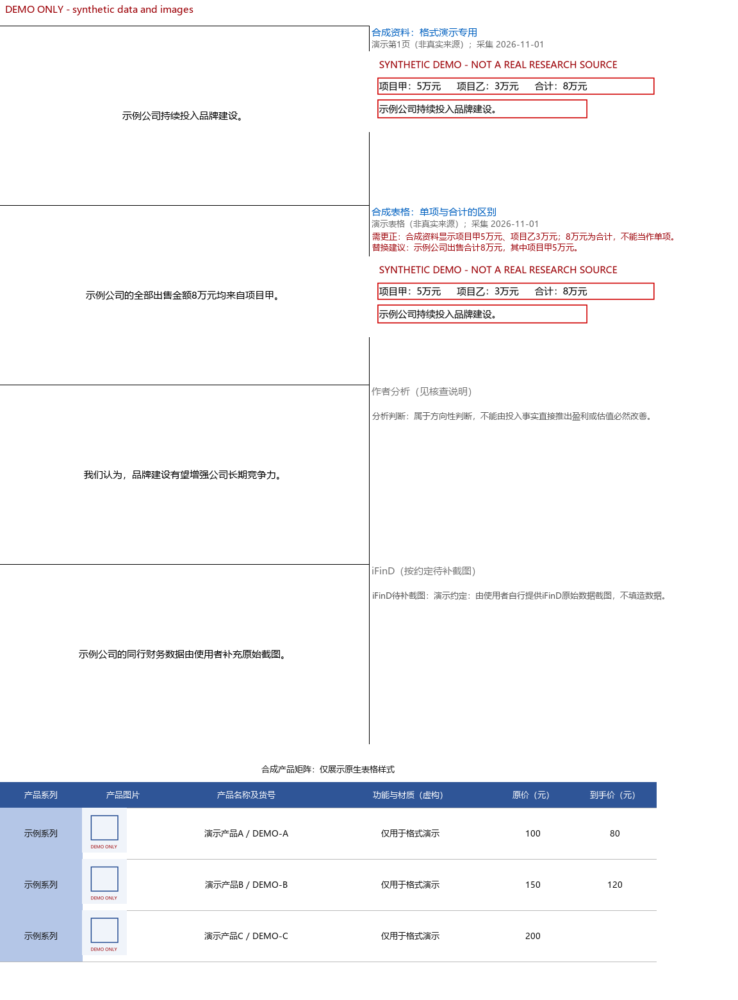

# report-workpaper · 研究报告底稿

对研究报告的正文和图表逐项核查原始来源，生成**原文可编辑、证据可追溯**的 Excel 底稿。适用于 Codex 等支持 `SKILL.md` 的助手，也提供独立 Python 命令行工具。

默认格式来自实际底稿整理经验的通用归纳；本仓库不包含真实研报、客户底稿、付费数据或登录凭据。



*以上全部为虚构数据和合成图片，只展示版式，不是真实研究证据。预览由 Pillow 生成，并非 Microsoft Excel 截图。*

## 默认生成什么

| 位置 | 内容 |
| --- | --- |
| 左侧 A:I | 可编辑报告原文，等线 11 号，自动换行，水平及垂直居中 |
| 右侧 J 列起 | 按句序排列来源，每个来源占 9 列；蓝色标题可点击 |
| 来源标题下 | PDF 物理页、印刷页或网页位置，以及采集日期 |
| 证据区域 | 真实来源截图、红框支撑句、对应核查说明与更正建议 |
| 数据及产品表 | 原生单元格，金额、比例和日期可编辑；蓝色表头、浅蓝系列列 |

条带以细黑线分隔，截图保持比例。正文与更正建议分别保留。优先级为：**本次用户要求 > 最新参考底稿 > 通用默认格式**。默认配置见 [analyst-format.json](assets/analyst-format.json)。

## 安装

已有同名 skill 时先备份，勿直接覆盖自己的改动。以下命令适用于全新安装：

```powershell
git clone https://github.com/Uaena-love-iu/report-workpaper.git "$env:USERPROFILE/.codex/skills/report-workpaper"
```

也可放到其他兼容工具的 skill 目录。助手入口为 [SKILL.md](SKILL.md)，提示示例：

> 使用 report-workpaper，根据我当前的底稿格式核查 3.4，保留原文、链接、双页码与截图，只修改 3.4 工作表；无法支撑的明确注明。

Python 建议使用 3.11 或更新版本。进入本项目目录后安装核心依赖：

```text
python -m pip install -r requirements.txt
python scripts/doctor.py
```

网页截图另需 `python -m pip install playwright`，可使用系统 Chrome/Edge；或执行 `python -m playwright install chromium`。PDF 裁图另需 `python -m pip install pdfplumber pypdfium2`。依赖检测只检查当前解释器，不会自动安装或修改浏览器设置。

Windows 优先使用 `python`，确保其确实指向已安装依赖的解释器。可通过 `REPORT_WORKPAPER_BROWSER` 指定浏览器可执行文件，通过 `REPORT_WORKPAPER_FONT` 指定预览使用的中文字体文件。Excel 字体以默认配置为准；宿主若要求专用电子表格工具，遵守宿主要求，用相同清单和格式驱动其原生 API。

## 先运行合成示例

```text
python scripts/make_demo.py --outdir outputs/demo
python scripts/verify_workbook.py outputs/demo/demo.xlsx
```

生成 Excel、来源占位图、清单、PNG 预览及结构检查结果。`examples/minimal.json` 的 `demo: true` 会在工作表顶部显示明显演示标记；生产底稿不得用合成图片充当证据。

## 实际工作流程

1. 从当前报告抽取章节、正文、表格及 Word 图表缓存；从提纲提取参考链接。
2. 每句分配稳定 ID，核实原始发布者、期间、口径、数字及因果关系。正文中的观点也需核查其事实前提。
3. 定位网页或 PDF 原文，截图、画框、检查截图可读性，保留页码、日期、链接及映射关系。
4. 按 [manifest 文档](references/manifest.md) 编制清单，验证后生成；若补既有底稿，先保护用户最新修改。
5. 检查 Excel 包结构、非目标内容及实际打开情况；研究证据另做人工审阅。

来源优先公司公告、监管、政府、官网及权威行业机构；机构媒体可补充。**券商研报、个人帖子和未经核实的转述不能作为事实底稿来源**。不能仅凭 HTTP 200 或搜索摘要宣称核实完毕。

```text
python scripts/extract_report.py --help
python scripts/split_sentences.py --help
python scripts/extract_outline_links.py outline.docx --charts --out outputs/outline-links.json
python scripts/validate_manifest.py manifest.json
python scripts/build_workpaper.py manifest.json --out outputs/workpaper.xlsx --preview-dir outputs/previews
```

网页截图示例，`--highlight` 须为页面上实际可见的逐字原文：

```text
python scripts/capture_source.py --url https://example.com/source --out outputs/source.png --highlight "来源页面中的原句"
python scripts/capture_pdf.py --help
```

截图成功只说明文件已保存；`unmatched`、`off_crop` 或 `requires_manual_review` 未解决时不能按已核实证据处理。登录和验证码由用户操作，不规避权限限制。PDF 物理页与印刷页分别记录；HTML/DOM 存档摘录明确标注，不能冒充原网页截图。

## 核查状态

| 状态 | 含义 |
| --- | --- |
| `support` | 逐句有已核实的有效截图支撑 |
| `partial` | 仅支撑部分内容，写明边界 |
| `correction` | 原文需更正，保留原文和具体替换建议 |
| `analysis` | 作者分析判断，不能冒充公司披露 |
| `unsupported` | 目前未找到支撑，保留检索过程 |
| `deferred_ifind` | 仅限用户明确约定自行补数据库截图的范围 |

脚本检查清单完整性，无法仅凭一个 `verified: true` 判断真实来源是否可信。状态和来源身份仍由核查者负责。更多例子见 [source-review.md](references/source-review.md)。

## 只修改某个工作表

禁止以旧文件重建用户已经修改的全本。先按现有格式完成目标表，再将其移植到新的候选文件：

```text
python scripts/patch_workbook.py current.xlsx edited-section.xlsx --sheet 3.4 --out outputs/candidate.xlsx --expected-sha256 ORIGINAL_SHA256 --report outputs/patch-report.json
python scripts/verify_workbook.py outputs/candidate.xlsx --baseline current.xlsx --allowed-sheet 3.4
```

候选文件与原文件路径必须不同。脚本核查原文件哈希，追加必要样式和图片，不通过高层库重存其他工作表；非目标内容及原有样式索引必须保持不变。目标表包含尚不支持的原生图表、特殊对象、表对象或条件格式等时，停止移植，改用宿主原生编辑流程。

移植工具只保护修改范围，**不保证独立编辑的目标表保留了原来的每句话和每张图**；执行者须先核对目标表自身的保留要求。详细限制见 [existing-workbooks.md](references/existing-workbooks.md)。

## 验证与限制

```text
python -m unittest discover -s tests -v
```

回归测试使用合成材料，检查原文可编辑、超链接、双页码、数据类型、图片去重、逐句覆盖约束、稀疏图表点位、单表更新保护、并发修改检测和不支持对象的拒绝处理。测试不联网，不需要账号。

- ZIP/关系/样式检查通过，不等于 Office 全规范验证，也不等于 Microsoft Excel 实际打开通过。
- PNG 是近似排版预览，Excel 的字体、换行及打印效果需实际检查。超长表按条带拆分预览时不包含表尾原生数据表，应在 Excel 另行检查。
- Python 后端不计算公式缓存；重要公式应由适用电子表格引擎重算后复核。
- 数据库口径、研究结论、来源真实性及截图红框语义，不能由结构测试代替判断。
- 不自动改写用户报告、不自动豁免财务数据，也不把资料缺失填为零。

旧截图式工作流保留为 `scripts/legacy_build_workpaper.py`；默认不再把左侧正文变成图片。它及 `render_paragraphs.py` 是兼容工具，平台字体及依赖可能需要单独配置。

## 版权与致谢

基于 Honghao Li 的原始 report-workpaper 工具扩展，保留原 MIT 许可与版权声明；本项目维护者为 [Uaena-love-iu](https://github.com/Uaena-love-iu)。本版新增可编辑底稿默认格式、逐句证据规则、双页码记录、指定表更新保护及合成回归测试。

代码采用 [MIT License](LICENSE)。真实来源截图及数据的权利属于各自权利人，代码许可不授予这些材料的使用或再分发权利。
